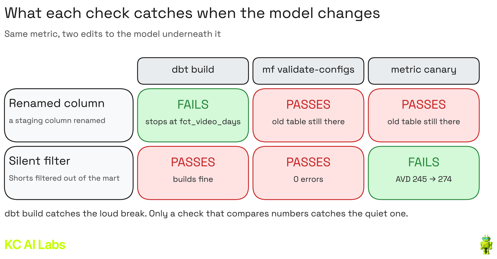

# YouTube Semantic Layer

A dbt Core + MetricFlow semantic layer on YouTube Analytics data in BigQuery, plus a metric canary: a pinned, independently reconciled answer that fails loudly when a metric's number moves.

Everything here is open source. [MetricFlow](https://github.com/dbt-labs/metricflow) has been Apache 2.0 since version 0.209.0, and dbt lists Snowflake, BigQuery, Databricks, Redshift and Postgres as [supported platforms](https://docs.getdbt.com/docs/build/about-metricflow), so the metric definitions move to another warehouse by swapping the dbt adapter (the staging SQL uses BigQuery syntax and needs a small rewrite).

Video walkthrough: [Kyle Chalmers Data Plus AI on YouTube](https://www.youtube.com/@kylechalmersdataai)

## Why a canary

`mf validate-configs` checks that the YAML parses, references resolve and the SQL runs against the warehouse. It never checks a value ([dbt docs](https://docs.getdbt.com/docs/build/validation)). A metric can pass every tier and still answer the wrong question, and a later change to a model can move a number without failing anything. The canary compares the numbers themselves.



## Data

The source tables come from the [youtube-bigquery-pipeline](https://github.com/kyle-chalmers/youtube-bigquery-pipeline) project:

| Table | Grain |
|---|---|
| `daily_video_analytics` | one row per video per activity day |
| `video_metadata` | one row per video per snapshot date (staging keeps the latest) |

The analytics table stores minutes watched and average view duration but not views, so `stg_daily_video_analytics` reconstructs views as `minutes watched * 60 / average view duration`. Days with an average view duration of 0 get null views.

Using your own data: point `models/staging/_sources.yml` at any table with a video id, a date, minutes watched and average view duration.

## Setup

```bash
python3 -m venv .venv && source .venv/bin/activate   # or: uv venv .venv
pip install -r requirements.txt
gcloud auth application-default login
cp profiles.yml.example profiles.yml                  # set your project; keep the dataset in the same location as your source
dbt build
mf validate-configs
```

Query a metric:

```bash
mf query --metrics avg_view_duration --group-by metric_time__month --start-time 2026-09-01 --end-time 2026-09-30
```

## Project layout

```
models/
  staging/     stg_daily_video_analytics, stg_video_metadata, metricflow_time_spine
  marts/       fct_video_days (one row per video per day, with video type)
  semantic/    semantic_models.yml, metrics.yml
canary/
  sql/         settled_months.sql (which refreshes changed a month's rows)
```

## Settled months

YouTube revises recent days, and the pipeline's weekly refresh reloads them. `canary/sql/settled_months.sql` counts how many rows each refresh changed for a month. Pin only months the refreshes have stopped changing; on this data that is about two weeks after the month closes.

## What the canary does not cover

- A baseline that was wrong from the start. Reconcile against independent SQL before pinning anything.
- Months still settling.
- A change in what a metric means that nobody writes down.
- The hosted dbt Semantic Layer APIs and BI integrations require the dbt platform. Nothing in this project does.

## References

- [MetricFlow commands](https://docs.getdbt.com/docs/build/metricflow-commands)
- [Ratio metrics](https://docs.getdbt.com/docs/build/ratio)
- [Open-sourcing MetricFlow](https://www.getdbt.com/blog/open-source-metricflow-governed-metrics)
- [dbt Discourse: testing strategies for the dbt Semantic Layer](https://discourse.getdbt.com/t/testing-strategies-for-dbt-semantic-layer/19811)

## License

MIT
